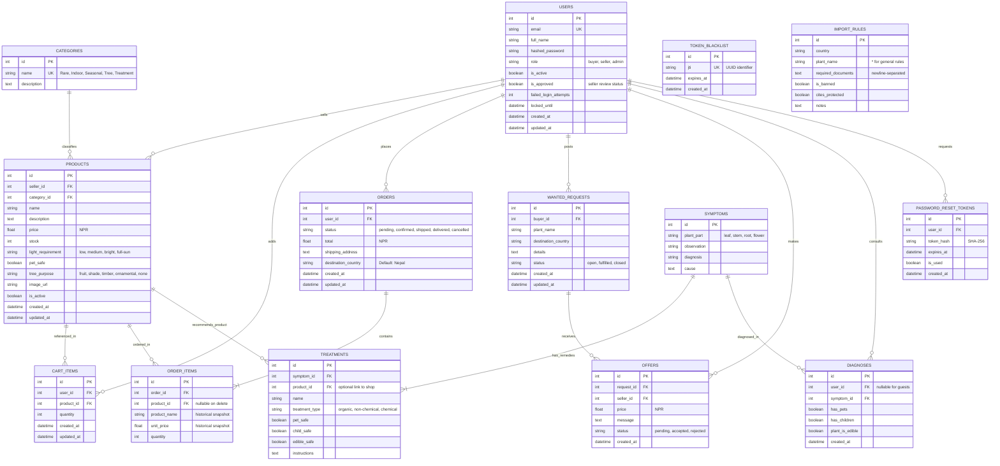

# RareRoot - Entity Relationship Diagram (ERD)

This document visualizes the complete database schema for the **RareRoot** botanical marketplace, covering user identity, e-commerce transactions, peer-to-peer sourcing, regulatory biosecurity compliance, and the AI-assisted Plant Doctor diagnostic engine.

## Schema Highlights

1. **Transactional Integrity & Audit Snapshots**:
   `ORDER_ITEMS` preserves `product_name` and `unit_price` at the moment of order placement. If a seller edits or hides a product later, historical order accounting remains strictly preserved.
2. **Soft Deletions**:
   Products referenced in past order records cannot be physically deleted; instead, they are deactivated (`is_active = False`) to maintain relational database integrity.
3. **Security State**:
   `TOKEN_BLACKLIST` ensures instant JWT invalidation upon logout or password change. `PASSWORD_RESET_TOKENS` stores single-use SHA-256 hashes with 15-minute expiration windows.
4. **Diagnostic Decoupling**:
   `SYMPTOMS` and `TREATMENTS` are isolated from machine learning dependencies, enabling plug-and-play integration for future MobileNetV2 vision models while preserving ranking logic.
