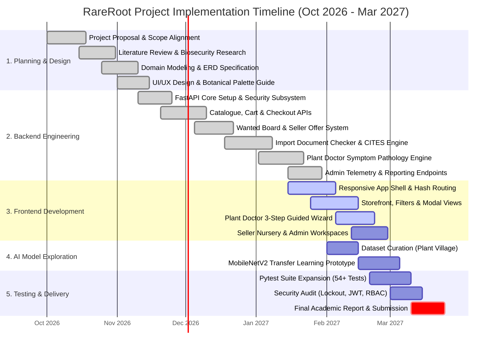

# RareRoot - Project Schedule (Gantt Chart)

This timeline details the engineering milestones spanning **October 2026 to March 2027** for the BSc Hons Computing Second Year Project.

## Milestone Deadlines

- **Milestone 1 (End of Nov 2026)**: Backend core architecture, database migrations, authentication, and security foundation complete.
- **Milestone 2 (End of Dec 2026)**: Marketplace catalogue, cart, transactional checkout, and Wanted Board operational.
- **Milestone 3 (End of Jan 2027)**: Plant Doctor clinical symptom diagnostic engine, CITES import checker, and admin analytics completed.
- **Milestone 4 (Mid Feb 2027)**: Frontend integration complete, zero-build single address serving at `http://127.0.0.1:8000`.
- **Milestone 5 (March 2027)**: Complete test verification (all 54 tests passing), cross-platform documentation, final university project defense.
