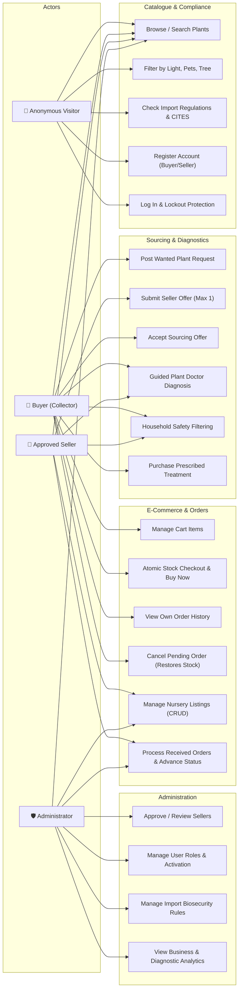

# RareRoot - System Use Cases

This document describes all operational use cases across the four primary system actors: **Visitor (Anonymous)**, **Buyer (Collector)**, **Seller (Approved Nursery)**, and **Administrator**.

## Detailed Use Case Matrix

| ID | Use Case | Primary Actor | Pre-Conditions | Flow / Post-Condition |
| :--- | :--- | :--- | :--- | :--- |
| **UC-01** | Browse Catalogue | Visitor, Buyer, Seller, Admin | None | Searches plants by keywords; filters by category, light, pet-safety, and tree purpose. |
| **UC-02** | Check Import Rules | Visitor, Buyer, Seller, Admin | Destination country selected | Combines general rules with target species; flags CITES or banned status; shows checklist. |
| **UC-03** | User Self-Registration | Visitor | Valid email, strong password | Registers as `buyer` (auto-approved) or `seller` (starts pending review). |
| **UC-04** | User Authentication | Registered User | Active account | Exchanges credentials for JWT. Enforces 15-min lockout after 5 consecutive failed passwords. |
| **UC-05** | Add to Cart & Checkout | Buyer | Logged in as Buyer | Merges duplicate items; validates stock atomically before deducting inventory and clearing cart. |
| **UC-06** | Cancel Pending Order | Buyer | Order status is `pending` | Buyer cancels order. Order becomes `cancelled` and reserved stock returns to inventory. |
| **UC-07** | Manage Nursery Listings | Approved Seller, Admin | Seller approved | Creates, edits, and toggles active state. Soft-hides products if present in historical orders. |
| **UC-08** | Fulfill Received Orders | Seller, Admin | Order contains seller items | Advances status strictly sequentially: `pending` &rarr; `confirmed` &rarr; `shipped` &rarr; `delivered`. |
| **UC-09** | Post Wanted Plant | Buyer | Logged in as Buyer | Publishes botanical request with delivery country and required specimen traits. |
| **UC-10** | Submit Sourcing Offer | Approved Seller | Request is `open` | Submits 1 competitive price offer with plant details. |
| **UC-11** | Accept Sourcing Offer | Buyer | Owner of open request | Accepts 1 offer; request becomes `fulfilled`; competing offers are automatically rejected. |
| **UC-12** | Consult Plant Doctor | Any User | None | 3-step wizard (Part &rarr; Observation &rarr; Household flags). Filters remedies and ranks organic-first. |
| **UC-13** | User Management | Administrator | Logged in as Admin | Changes user roles, approves new nurseries, activates/deactivates accounts (self-deactivation barred). |
| **UC-14** | Import Rules Administration | Administrator | Logged in as Admin | Full CRUD for biosecurity import documentation and CITES protective restrictions. |
| **UC-15** | Platform Analytics | Administrator | Logged in as Admin | Monitors net sales volume (excludes cancelled), orders breakdown, top products, and common diagnoses. |
