# RareRoot - Work Breakdown Structure (WBS)

This document delineates the hierarchical decomposition of deliverables and operational activities for the **RareRoot** university engineering project.

```mermaid
flowchart TD
    RR["RareRoot Project (Level 1)"]

    %% Level 2
    RR --> PM["1.0 Project Management"]
    RR --> DES["2.0 System Design & Architecture"]
    RR --> SEC["3.0 Security & Identity"]
    RR --> MKT["4.0 Botanical Marketplace"]
    RR --> CMP["5.0 Compliance & Sourcing"]
    RR --> DOC["6.0 Plant Doctor AI Diagnostics"]
    RR --> ADM["7.0 Administration & Telemetry"]
    RR --> QAD["8.0 Quality Assurance & Delivery"]

    %% Level 3 PM
    PM --> PM1["1.1 Academic Project Proposal"]
    PM --> PM2["1.2 Milestone & Timeline Scheduling"]
    PM --> PM3["1.3 Technical Documentation & Dashain Report"]

    %% Level 3 DES
    DES --> DES1["2.1 Domain Relational Modeling (14 Entities)"]
    DES --> DES2["2.2 RESTful API Specification (FastAPI / OpenAPI)"]
    DES --> DES3["2.3 UI/UX Design System (Fraunces & Public Sans)"]

    %% Level 3 SEC
    SEC --> SEC1["3.1 Bcrypt Password Hashing & Policy Engine"]
    SEC --> SEC2["3.2 JWT Session Lifecycle & Blacklist Invalidation"]
    SEC --> SEC3["3.3 Lockout Shield (5 Failures -> 15min 429)"]
    SEC --> SEC4["3.4 Role-Based Access Control (RBAC Server Dependencies)"]

    %% Level 3 MKT
    MKT --> MKT1["4.1 Multi-Criteria Plant Catalogue & Search Engine"]
    MKT --> MKT2["4.2 Seller Inventory Management & Soft Deletions"]
    MKT --> MKT3["4.3 Shopping Cart Sync & Stock Verification"]
    MKT --> MKT4["4.4 Atomic Checkout & Instant Buy-Now Flow"]
    MKT --> MKT5["4.5 Sequential Order State Machine & Stock Rollback"]

    %% Level 3 CMP
    CMP --> CMP1["5.1 Wanted Plant Board & Seller Offer Exchange"]
    CMP --> CMP2["5.2 Destination Biosecurity & Document Aggregator"]
    CMP --> CMP3["5.3 CITES Appendix Verification & Banned Weeds Alert"]

    %% Level 3 DOC
    DOC --> DOC1["6.1 3-Step Guided Symptom Diagnostic Wizard"]
    DOC --> DOC2["6.2 Household Safety Filtering (Pets/Children/Edible)"]
    DOC --> DOC3["6.3 Organic-First Multi-Tier Remedy Ranking"]
    DOC --> DOC4["6.4 Shop Treatment Linking & Cart Integration"]
    DOC --> DOC5["6.5 Decoupled MobileNetV2 Vision Architecture Hook"]

    %% Level 3 ADM
    ADM --> ADM1["7.1 User Account Administration & Nursery Vetting"]
    ADM --> ADM2["7.2 Import Regulation Rules CRUD Engine"]
    ADM --> ADM3["7.3 Business & Epidemiological Diagnostics Reporting"]

    %% Level 3 QAD
    QAD --> QAD1["8.1 Pytest Automated Suite (54+ Test Cases)"]
    QAD --> QAD2["8.2 Cross-Platform Launchers (run.bat & run.sh)"]
    QAD --> QAD3["8.3 Final Deployment Package & University Defense"]
```

## Work Package Deliverables Summary

1. **WP-100 Project Management**: Academic proposal, WBS, Gantt roadmap, and project report.
2. **WP-200 System Design**: ERD, Use Case specifications, and botanical design system with calming forest palette.
3. **WP-300 Security & Identity**: Server-side RBAC dependencies, JWT blacklisting, rate-limited lockout protection, and single-use SHA-256 password resets.
4. **WP-400 Botanical Marketplace**: Search/filtering by light, pets, and tree purpose; inventory management with order history soft-delete preservation; atomic stock checkout.
5. **WP-500 Sourcing & Compliance**: P2P wanted board with offer competition; import document checker with CITES warnings and banned invasive plant alerts for 5 major jurisdictions.
6. **WP-600 Plant Doctor AI**: Guided 3-step diagnostic flow; ranked remedies (organic &rarr; non-chemical &rarr; chemical); safety filters for pets, children, and edible crops; consultation history.
7. **WP-700 Administration**: Seller verification, user role adjustments, regulatory rules manager, and sales analytics excluding cancelled orders.
8. **WP-800 QA & Delivery**: Comprehensive pytest suite (54 automated tests), Windows/Linux runners, and GitHub versioning guidelines.
